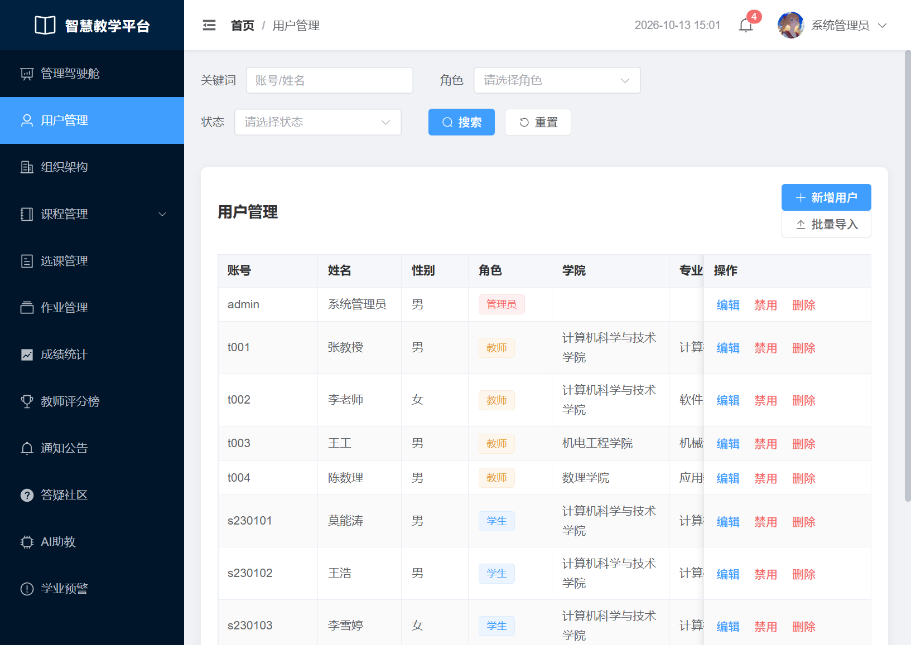
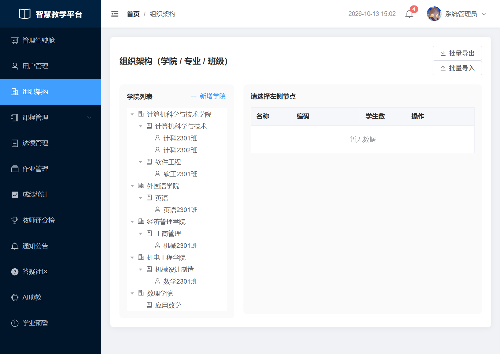
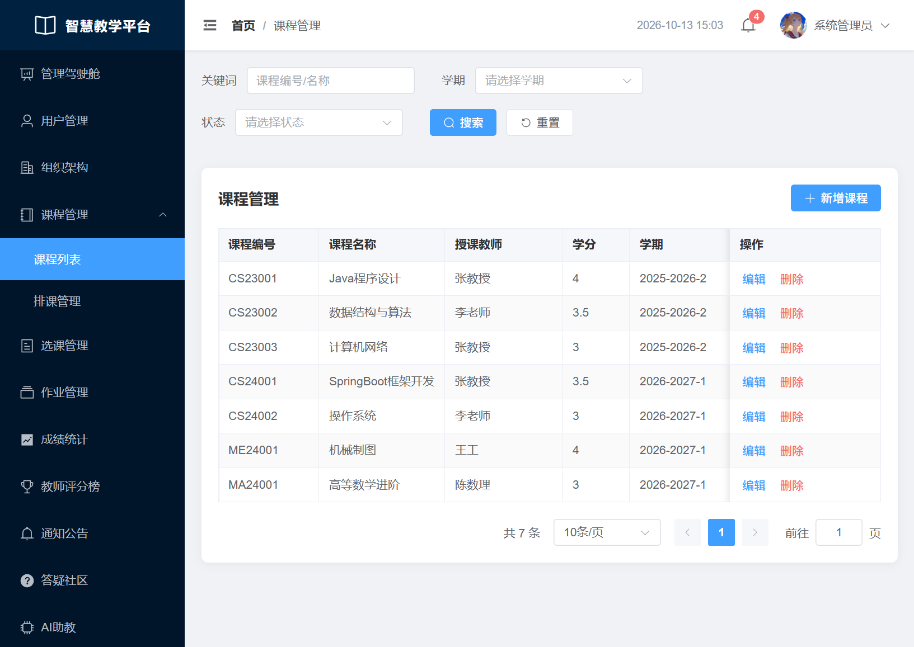
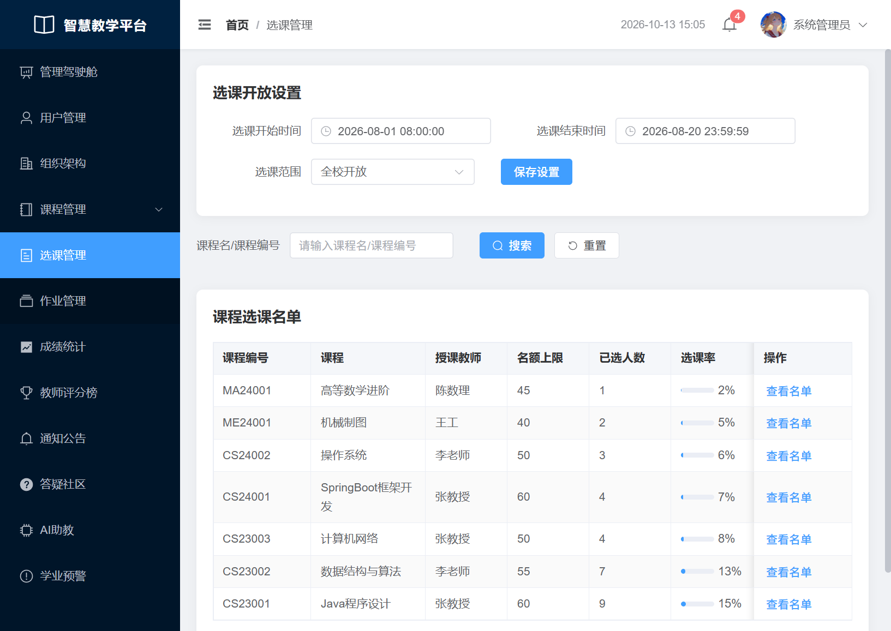
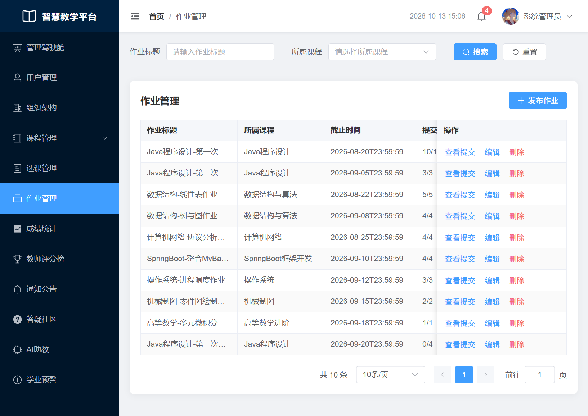
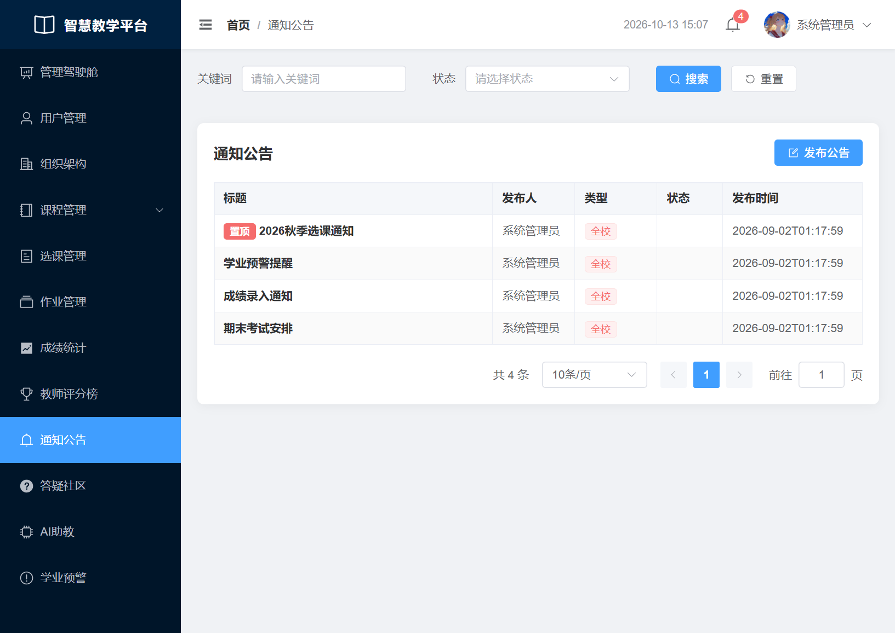
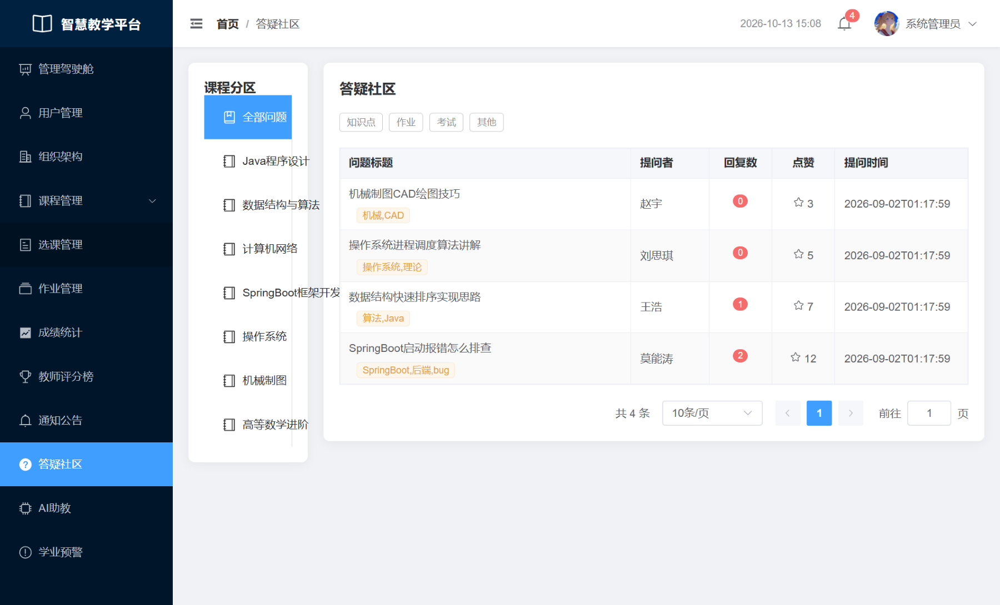
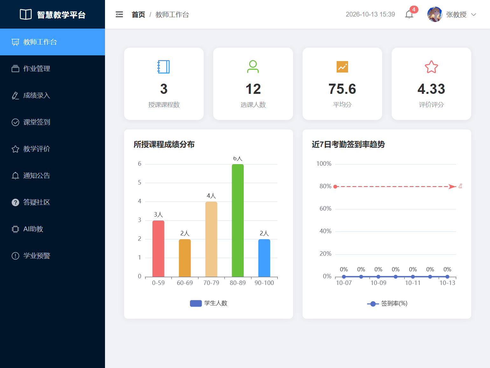
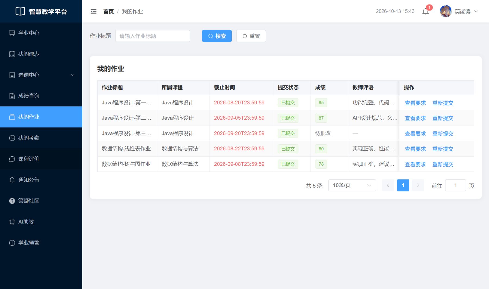

# MNT-SmartTeaching 智能教学管理系统

高校轻量化教务管理系统 · Spring Cloud 微服务 · Spring Boot 4 + Vue3
仓库：https://github.com/moNT-nengtao/MNT-SmartTeaching.git

覆盖用户权限、课程排课、选课成绩、考勤签到、学业预警、AI 助教、数据仪表盘、作业通知等完整教务闭环，管理员 / 教师 / 学生三角色统一入口，各角色拥有独立工作台与功能菜单。

## 功能总览

| 角色 | 核心功能 |
|---|---|
| 管理员 | 管理驾驶舱、用户管理、组织架构、课程管理、排课管理、选课管理、作业管理、成绩统计、教师评分榜、通知公告、答疑社区、AI 助教、学业预警 |
| 教师 | 教师工作台、作业管理、成绩录入、课堂签到（九宫格）、教学评价、通知公告、答疑社区、AI 助教、学业预警 |
| 学生 | 学业中心、我的课表、选课大厅 / 我的选课、成绩查询、我的作业、我的考勤（九宫格签到）、课程评价、通知公告、答疑社区、AI 助教、学业预警 |

以下截图均为本系统真实运行画面。

## 管理员端

登录页支持账号密码 + 三角色切换，登录后按角色进入各自工作台。


管理驾驶舱汇总全校核心指标：班级 / 教师 / 学生 / 课程总数、选课率、考勤合格率，并配各学院学生分布、师生比例、近 7 日系统活跃度图表。


用户管理支持关键词 / 角色 / 状态筛选，新增、批量导入用户，一键禁用 / 删除，三角色账号统一维护。



组织架构以「学院 → 专业 → 班级」树形结构管理，支持批量导入导出，班级归属一目了然。



课程管理维护课程编号、名称、授课教师、学分、学期与人数上限，支持多学期数据并存。



排课管理内置班级 / 教师 / 教室三重冲突校验，支持手动排课、批量排课与课表导出。


选课管理可配置选课开放时间与选课范围，逐课程查看已选人数与选课率，一键查看选课名单。



作业管理按课程发布作业，实时统计提交进度（如 10/10），教师可查看提交详情并批改。



成绩统计给出总人数、平均分、及格率、挂科人数，附成绩分布、各学院平均分对比，并自动筛查异常成绩（如低于 60 分），支持导出。


教师评分榜汇总学生五维课程评价，前三名以卡片突出展示，综合评分按百分比呈现。


通知公告支持置顶、按状态筛选，用于发布选课、考试、成绩录入等全校通知。



答疑社区按课程分区，问题带知识点 / 作业 / 考试 / 其他分类标签，支持点赞与回复，师生在线互动。



AI 助教接入本地大模型，提供知识点答疑、作业评语生成、学业分析三种模式，历史会话可追溯，每日限额防滥用。


学业预警统计旷课 / 挂科 / 作业未交三类预警，自动生成预警记录与原因说明，支持导出预警报告，与考勤、成绩模块联动。


## 教师端

教师工作台汇总授课课程数、选课人数、平均分与评价评分，配所授课程成绩分布与近 7 日考勤签到率趋势。



成绩录入按课程批量录入平时 / 期末成绩，综合成绩与等级自动计算，实时统计平均分与及格人数，一键保存全部。


课堂签到采用九宫格图案签到：教师滑动绘制随机图案生成签到会话，学生须绘制同一图案完成签到，有效防止代签；考勤名单自动区分成功 / 迟到 / 旷课。


教学评价以五维雷达图呈现授课能力、课堂氛围、知识讲解、作业批改、答疑服务评分，逐条展示学生评语与分项打分。


## 学生端

学业中心汇总当前 GPA、已修学分、本月考勤率与挂科科目，配各科成绩雷达图、绩点趋势、月度考勤统计与各科成绩对比。


选课大厅在选课开放时间内供学生选课 / 退课，课程卡片展示授课教师、上课时间、学分、剩余名额与评分；「智能推荐」基于学业数据个性化推荐课程。


我的作业查看作业要求、截止时间与提交状态，已批改作业可见成绩与教师评语，支持重新提交。



我的考勤与教师端九宫格签到联动：老师发起签到后学生滑动绘制图案立即签到，考勤记录完整呈现每次签到时间与状态。


## 技术架构

```
Browser
   │  http://localhost:5173 开发 (Vue3 + Vite) / http://localhost:8888 生产 (Nginx)
   ▼
Gateway  :8080  API 网关（前缀路由 / JWT 鉴权 / CORS）
   │  Nacos 注册中心 :9848
   ├── uaa-service             :8081  认证 / 用户 / 组织
   ├── course-service          :8082  课程 / 排课
   ├── selection-score-service :8083  选课 / 成绩
   ├── attendance-service      :8084  考勤签到
   ├── warning-service         :8085  学业预警
   ├── ai-service              :8086  AI 助教（Ollama）
   ├── analysis-service        :8087  数据仪表盘
   └── teaching-service        :8088  作业 / 通知 / 评价 / 答疑
              │  OpenFeign 契约调用（内部标识防越权）
              ▼
        MySQL（多服务共享单库） + Redis（缓存 / 黑名单 / 限额）
```

8 个业务微服务 + 1 网关按业务域独立部署：Nacos 注册发现、Gateway 统一入口按前缀路由、OpenFeign 契约调用并携带内部标识防越权，服务间不直连对方数据库。统一 Spring Security + JWT 三角色权限，登出令牌进 Redis 黑名单立即失效。考勤、成绩、预警模块间通过微服务调用自动联动（如缺勤自动落实旷课并触发预警），体现微服务解耦后的业务闭环。

## 技术栈

| 分类 | 选型 |
|---|---|
| 语言 / 框架 | Java 17 · Spring Boot 4.0.8 · Spring Cloud 2025.1.0 |
| 微服务组件 | Spring Cloud Gateway · Nacos 3.2.4 · OpenFeign |
| 数据持久化 | MyBatis-Plus 3.5.17 · MySQL 8 |
| 缓存 | Spring Data Redis（Lettuce + commons-pool2） |
| 认证授权 | Spring Security + JWT（登出令牌进 Redis 黑名单） |
| AI 能力 | Ollama + Qwen3 本地大模型 |
| 前端 | Vue3 · Vite · Element Plus · ECharts · Axios |
| 部署 | Nginx 反向代理 · Windows 服务（MySQL / Redis） |

## 快速开始

### 0. 环境准备

| 组件 | 版本 | 检查方式 |
|---|---|---|
| JDK | 17+ | `java -version` |
| Node.js | 18+ | `node -v` |
| MySQL | 8.x | 系统服务 `MySQL80`，账号 root/123456 |
| Redis | 任意 | 系统服务 `Redis`，密码 123456 |
| Nacos | 3.2.4 | 解压到仓库同级目录 `nacos-server-3.2.4/`（不入库） |

一键启动脚本会自动检查以上环境，缺什么直接提示，不会空跑。

### 1. 初始化数据库

```bash
mysql -uroot -p123456 < sql/smart_teaching_mysql.sql
```

### 2. 构建后端

```bash
cd smart-teaching-cloud
mvn clean package -DskipTests
```

### 3. 安装前端依赖

```bash
cd smart-teaching-web
npm install
```

### 4. 一键启动（开发模式）

双击 `scripts/start-all.cmd`，静默启动、日志落盘、后台运行：

```
MySQL → Redis → Nacos → 9 个微服务 → 前端 Vite
```

启动完成后自动汇总各端口状态（OK / DOWN）。日常开发改代码即时生效，页面入口 http://localhost:5173。

### 5. 验证（开发模式）

| 入口 | 地址 | 说明 |
|---|---|---|
| 前端页面 | http://localhost:5173 | Vite 开发模式，/api 已代理到网关 |
| 网关接口 | http://localhost:8080/api/xxx | 后端接口统一入口 |
| Nacos 控制台 | http://localhost:8089/nacos | 账号 nacos / nacos |

登录测试账号 `admin / 123456`（管理员）、`t001 / 123456`（教师）、`s230101 / 123456`（学生）。

### 6. 生产部署（Nginx）

构建前端并通过 Nginx 托管，贴近真实部署：双击 `scripts/start-prod.cmd`，自动完成 环境自检 → 构建前端 → 生成 Nginx 配置 → 启动 Nginx → 校验 ：

```
页面入口  http://localhost:8888   （Nginx 托管 dist，/api 反向代理到网关 8080）
停止部署  scripts/stop-prod.cmd
```

- 依赖后端已运行（网关 8080 未启动会提示先跑 `start-all.cmd`）；前端改动需重新 `start-prod.cmd`（或 `scripts/build-web.cmd` 单独构建）
- 默认端口 8888（80 常被占用）；如需更换，改 `scripts/start-prod.ps1` 顶部 `$Port`
- 项目位于中文路径时，脚本自动在 `C:\Users\Public` 建立 junction 映射，以纯 ASCII 路径运行 Nginx（Windows 版 Nginx 无法直接处理中文路径）

### 7. 停止

双击 `scripts/stop-all.cmd`，停止 Nacos、微服务与前端（MySQL / Redis 保留运行）；生产模式单独用 `scripts/stop-prod.cmd` 停止 Nginx。

### 8. 常见问题

- **服务全部 DOWN**：检查 MySQL / Redis 是否运行、Nacos 是否就绪，日志在 `smart-teaching-cloud/<模块>/target/*.log`
- **前端 404 / 接口不通**：确认网关 8080 已启动，前端 /api 代理指向网关
- **端口被占用**：服务端口固定 8080-8088，释放占用或修改服务配置；生产页面 8888 被占用则改 `start-prod.ps1` 顶部 `$Port`
- **Nacos 启动卡住**：确认已解压 nacos-server-3.2.4 且 JDK 匹配，日志见 `nacos-server-3.2.4/nacos-start.log`
- **生产模式页面打不开**：先跑 `start-all.cmd` 起后端，再跑 `start-prod.cmd`；Nginx 日志在 `nginx-1.31.3/logs/error.log`

## 目录结构

```
MNT-SmartTeaching/
├── smart-teaching-cloud/       # 后端微服务工程（11 个 Maven 模块）
│   ├── common/                 # 公共模块（工具/异常/公共配置/公共 Mapper）
│   ├── api/                    # OpenFeign 接口契约
│   ├── gateway-service/        # 网关
│   └── *-service/              # 8 个业务服务
├── smart-teaching-web/         # 前端 Vue3 工程
├── sql/                        # 数据库初始化脚本
├── docs/screenshots/           # 功能演示截图（本 README 配图）
├── scripts/                    # 全部脚本（公共定义统一在 lib\common.ps1）
│   ├── start-all / stop-all    # 开发模式一键启动 / 停止（Nacos + 9 服务 + Vite + Nginx）
│   ├── start-prod / stop-prod  # 生产模式启动 / 停止（Nginx 托管 + 反向代理）
│   ├── build-web               # 单独构建前端 dist
│   ├── lib/common.ps1          # 路径 / 端口 / 工具函数（各脚本共用）
│   └── nginx/                  # Nginx 生产配置模板
└── README.md
```

## 注意事项

- Nacos、Nginx 为本地运行环境，不入库，克隆后需自行准备
- 数据库为多服务共享单库，跨服务数据访问统一经 OpenFeign 契约，不直连其他服务表
- 以上功能截图运行于生产模式（Nginx :8888），登录账号为系统预置测试数据
